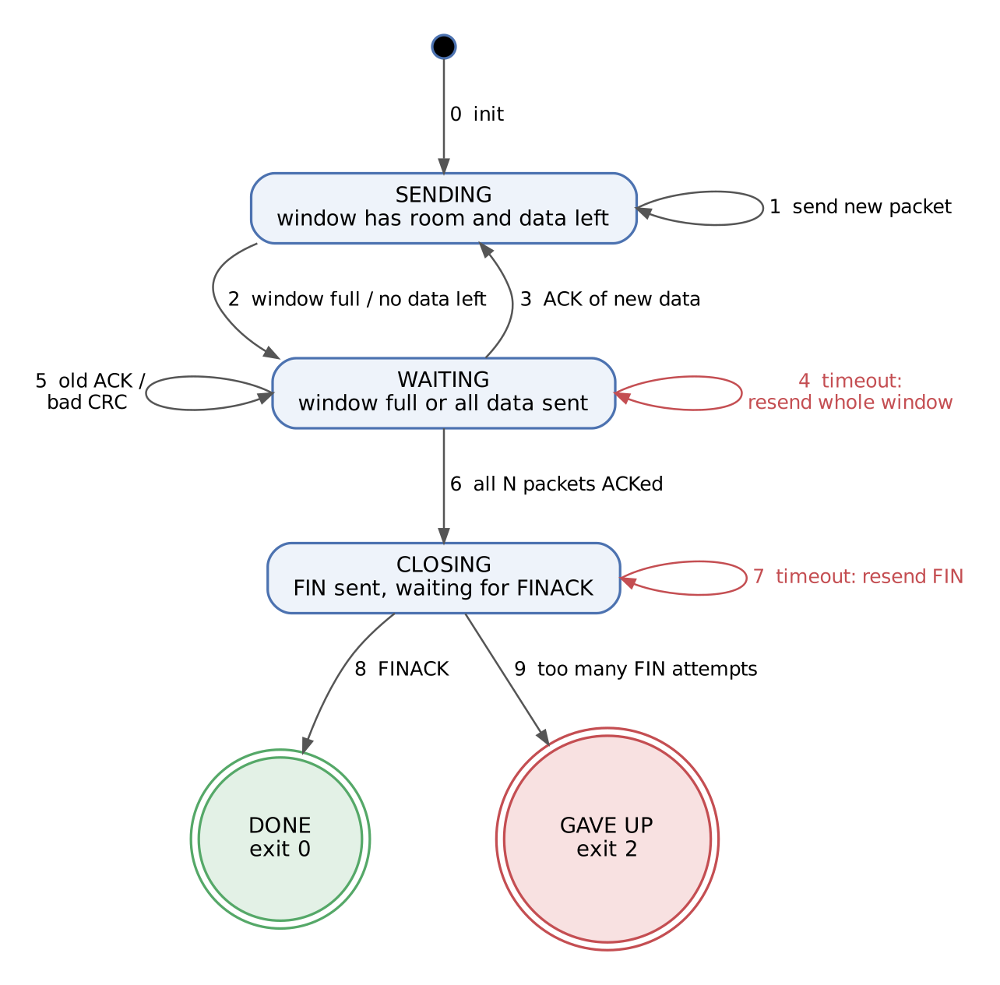
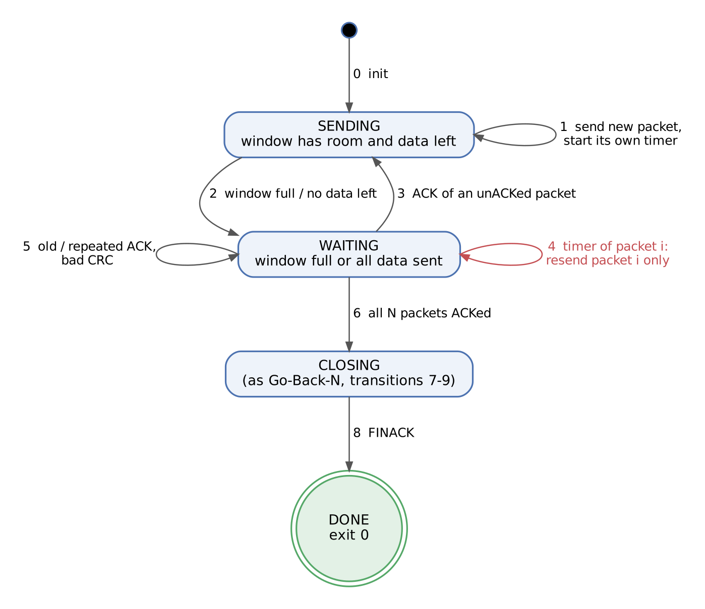
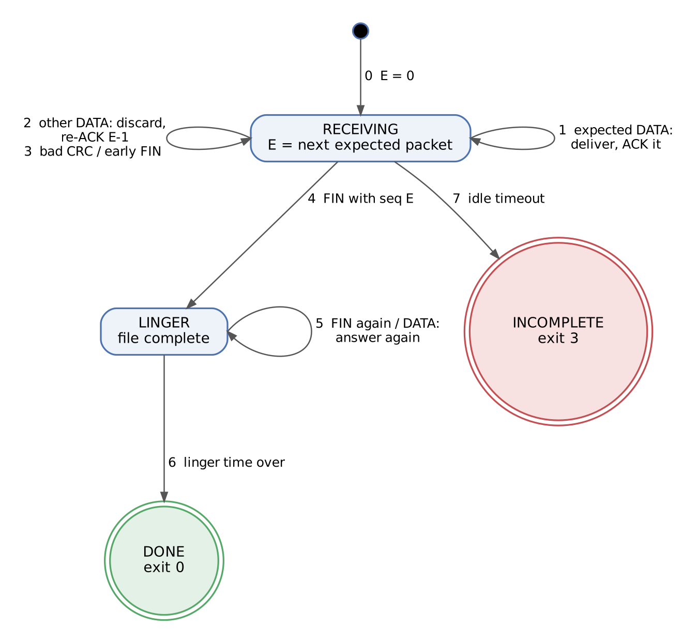
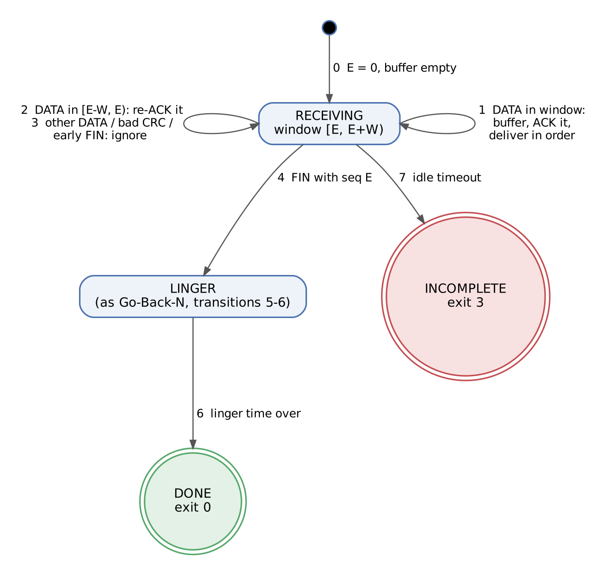

# 1. Overview

A sender transfers one file to a receiver over UDP, through the impairment
emulator (`sender → emulator → receiver`, ACKs on the reverse path). Data flows
only from sender to receiver; the receiver sends only control packets (ACK,
FINACK). The ARQ protocol is chosen at run time (`-p sw|gbn|sr`) together with
the window W (`-w`), the sequence-number bits k (`-k`, 1 ≤ k ≤ 16) and the
maximum payload (`-s`, default 1024 B). Sender and receiver must be started
with the same protocol, W and k.

# 2. Packet format

Every packet is a 12-byte binary header followed by an optional payload. All
multi-byte fields are big-endian (network byte order). The header is written
byte by byte (`pkt_pack`), never by copying a C struct, so the layout does not
depend on the compiler's padding or the host's byte order.

| Offset | Size | Field | Meaning |
|------|-----|--------|--------------------------------------------------|
| 0 | 1 | type | 0 = DATA, 1 = ACK, 2 = FIN, 3 = FINACK |
| 1 | 1 | flags | reserved, 0 |
| 2 | 2 | len | payload length in bytes (0 for control packets) |
| 4 | 4 | num | sequence number (DATA, FIN) or acknowledgment number (ACK, FINACK); only the low k bits are used |
| 8 | 4 | crc | CRC-32 over header and payload, computed with this field set to 0 |
| 12 | len | payload | file bytes (DATA only) |

**Checksum.** CRC-32 of IEEE 802.3 (reflected polynomial 0xEDB88320, initial
value and final XOR 0xFFFFFFFF), implemented in `crc32.c` without external
libraries; check value `crc32("123456789") = 0xCBF43926`. It detects every
single-bit error (the emulator's corruption flips exactly one bit), every burst
of up to 32 bits, and a random error pattern with probability 1 − 2⁻³².

**Validation.** A datagram is dropped silently (and logged as `CORRUPT`) if it
is shorter than 12 bytes, if `len` disagrees with the datagram size, if `type`
is unknown, or if the CRC does not match.

**Why FIN and FINACK.** The receiver does not know the file size in advance,
so the sender must say when the file is complete. A separate FIN type, carrying
the number N mod 2^k of the first packet that does *not* exist, tells the
receiver "every packet before this one was sent". A separate FINACK type is
used, rather than an ordinary ACK, so that a delayed data ACK with the same
number can never be mistaken for the end of the transfer.

# 3. Sequence numbers

Internally both ends count packets with an absolute index 0 … N−1
(N = ⌈file size / payload⌉); only `index mod 2^k` is sent. An incoming number
a is mapped back to an absolute index by its distance from the start of the
current window:

  d = (a − base) mod 2^k,  index = base + d

* Sender: an ACK refers to packet base + d if d < (packets in flight);
  otherwise it is old and ignored.
* Receiver (expected packet E): d = (s − E) mod 2^k decides between "expected",
  "inside the window" and "old".

This mapping is unambiguous only if the window respects the sequence-number
limit: **W ≤ 2^k − 1 for Go-Back-N** and **W ≤ 2^(k−1) for Selective Repeat**
(proof in `docs/derivations.md` §4). The sender prints a warning but accepts
larger windows (up to 2^k), so that experiment 5 can show the failure.

# 4. Acknowledgments

| Protocol | ACK sent by receiver | Meaning for the sender |
|--------------|---------------------------------------------|------------------------------|
| Stop-and-Wait | number of the packet just received in order; for anything else the last in-order packet E−1 | cumulative (W = 1) |
| Go-Back-N | same as Stop-and-Wait | cumulative: "every packet up to and including this one" |
| Selective Repeat | number of the packet just received (also for buffered and old duplicate packets) | individual: "this packet" |

Stop-and-Wait is implemented as the W = 1 case of the Go-Back-N machinery: one
packet in flight, one timer, cumulative ACK.

# 5. Retransmission timer (RTO)

RFC 6298 estimator (`rto.c`), one estimator per sender:

* first sample R: SRTT = R, RTTVAR = R/2; then RTTVAR = ¾·RTTVAR + ¼·|SRTT − R|,
  SRTT = ⅞·SRTT + ⅛·R;
* RTO = SRTT + 4·RTTVAR, clamped to [200 ms, 60 s]; initial RTO 1 s
  (`--rto-init`, `--rto-min`, `--rto-max`). The minimum is 200 ms as in Linux,
  not RFC 6298's 1 s, because the baseline RTT is only ≈ 48 ms;
* on a timeout the RTO doubles (exponential backoff);
* **Karn's rule**: no RTT sample from a packet that was ever retransmitted;
* when an ACK acknowledges new data the backoff is cleared (RTO recomputed from
  SRTT and RTTVAR) even if Karn's rule forbids a sample. Without this, Go-Back-N
  at 10 % loss, which retransmits almost every packet, never obtains a valid
  sample and its RTO grows without bound (51 s was observed during testing);
* Selective Repeat: if several packet timers expire at the same moment, the RTO
  is doubled once, not once per packet.

Timer placement: Go-Back-N and Stop-and-Wait keep one timer for the oldest
unacknowledged packet, restarted whenever an ACK acknowledges new data.
Selective Repeat keeps one deadline per packet, set when the packet is
(re)transmitted.

# 6. State machines

Notation: base = oldest unacknowledged packet, next = next new packet, N =
number of packets, M = 2^k, E = next packet the receiver expects. The numbers
on the arrows refer to the tables; the event names in brackets are the ones
written to the log.

## 6.1 Sender — Stop-and-Wait and Go-Back-N

{ width=72% }

| # | From → to | Event (guard) | Action [log event] |
|-----|----------------|------------------------|--------------------------------------------------|
| 0 | start → SENDING | program starts | base = next = 0, RTO = 1 s |
| 1 | SENDING → SENDING | next < base + W and next < N | send DATA(next mod M) [SEND]; if base = next start the timer; next = next + 1 |
| 2 | SENDING → WAITING | next = base + W or next = N | wait for an ACK or the timer |
| 3 | WAITING → SENDING | ACK a with d = (a − base) mod M < next − base | base = base + d + 1 [ACK]; RTT sample of packet base+d unless it was retransmitted [RTT / RTT_SKIP], clear backoff; restart the timer if base < next, otherwise stop it |
| 4 | WAITING → WAITING | timer expires | RTO = 2·RTO [TIMEOUT]; resend every packet base … next−1 [RETX]; restart the timer |
| 5 | WAITING → WAITING | ACK with d ≥ next − base, or CRC error | ignore [ACK_DUP / CORRUPT] |
| 6 | WAITING → CLOSING | base = N | [DATA_DONE] (its `rtt_us` field is the completion time); send FIN(N mod M) [FIN] |
| 7 | CLOSING → CLOSING | no FINACK within RTO | RTO = 2·RTO; resend FIN [FIN_RETX] |
| 8 | CLOSING → DONE | FINACK(N mod M) | [FINACK]; exit 0 |
| 9 | CLOSING → GAVE UP | `--fin-retries` FINs sent (default 10) | [FIN_GIVEUP]; exit 2 (all data was ACKed, only the FINACK is missing) |

## 6.2 Sender — Selective Repeat

{ width=72% }

| # | From → to | Event (guard) | Action [log event] |
|-----|----------------|------------------------|--------------------------------------------------|
| 0 | start → SENDING | program starts | base = next = 0, RTO = 1 s |
| 1 | SENDING → SENDING | next < base + W and next < N | send DATA(next mod M) [SEND]; deadline[next] = now + RTO; next = next + 1 |
| 2 | SENDING → WAITING | window full or next = N | wait for an ACK or the earliest deadline |
| 3 | WAITING → SENDING | ACK a, i = base + (a − base) mod M, i < next, not yet ACKed | acked[i] = 1 [ACK]; RTT sample of i unless retransmitted [RTT / RTT_SKIP]; while acked[base]: base = base + 1 |
| 4 | WAITING → WAITING | deadline[i] passed for one or more unACKed i | RTO = 2·RTO once [TIMEOUT]; resend only those packets [RETX]; deadline[i] = now + RTO |
| 5 | WAITING → WAITING | ACK outside the window or already ACKed, CRC error | ignore [ACK_DUP / CORRUPT] |
| 6 | WAITING → CLOSING | base = N | as Go-Back-N (transitions 6–9) |

## 6.3 Receiver — Stop-and-Wait and Go-Back-N

{ width=68% }

| # | From → to | Event (guard) | Action [log event] |
|-----|----------------|------------------------|--------------------------------------------------|
| 0 | start → RECEIVING | program starts | E = 0, open the output file |
| 1 | RECEIVING → RECEIVING | DATA with s = E mod M | append the payload to the file [RX_DATA]; E = E + 1; send ACK(s) [ACK_TX] |
| 2 | RECEIVING → RECEIVING | DATA with any other s | discard [RX_DUP if s = (E−1) mod M, else RX_DISCARD]; if E > 0 send ACK(E−1) |
| 3 | RECEIVING → RECEIVING | CRC error; FIN with s ≠ E mod M | drop [CORRUPT]; ignore [FIN_EARLY] |
| 4 | RECEIVING → LINGER | FIN with s = E mod M | flush and close the file [FIN_RX]; send FINACK(s) [FINACK_TX]; linger timer = `--linger` (default 2 s) |
| 5 | LINGER → LINGER | FIN again (FINACK was lost); DATA | answer FINACK again and restart the linger timer [FIN_DUP]; re-ACK DATA [RX_DUP] |
| 6 | LINGER → DONE | linger timer expires | [DONE]; exit 0 |
| 7 | RECEIVING → INCOMPLETE | no valid packet for `--idle` (default 30 s) | [IDLE_TIMEOUT]; exit 3 |

## 6.4 Receiver — Selective Repeat

{ width=68% }

For a DATA packet with number s let d = (s − E) mod M.

| # | From → to | Event (guard) | Action [log event] |
|-----|----------------|------------------------|--------------------------------------------------|
| 0 | start → RECEIVING | program starts | E = 0, reorder buffer of W slots empty |
| 1 | RECEIVING → RECEIVING | d < W (inside [E, E+W)) | if the slot is empty, store the payload [RX_DATA if d = 0, else RX_BUF], otherwise [RX_DUP]; send ACK(s); then write consecutive stored packets E, E+1, … to the file, E = E + 1 for each |
| 2 | RECEIVING → RECEIVING | d ≥ M − W (inside [E−W, E): already delivered) | send ACK(s) again [RX_DUP] (its first ACK was probably lost) |
| 3 | RECEIVING → RECEIVING | any other d; CRC error; early FIN | ignore [RX_IGNORE / CORRUPT / FIN_EARLY] |
| 4–7 | | | as Stop-and-Wait / Go-Back-N |

The two ranges of transitions 1 and 2 are disjoint only if W ≤ M/2: this is
exactly the Selective Repeat window limit.

# 7. Connection teardown

1. After the last data packet is acknowledged the sender sends FIN with number
   N mod M and retransmits it with the RTO (doubling) until a matching FINACK
   arrives or `--fin-retries` attempts were made.
2. The receiver accepts FIN only if its number equals E mod M, i.e. after every
   data packet has been written in order. It answers FINACK and stays in LINGER
   for `--linger` ms, answering every repeated FIN, because its FINACK may be
   lost.
3. If every FINACK is lost the sender gives up with exit code 2. The file is
   still complete: the sender knows every data packet was acknowledged, it only
   cannot confirm that the receiver closed it (the two-generals problem has no
   solution over a lossy channel; a bounded number of retries is the standard
   compromise).

# 8. Run-time parameters

| Program | Option | Meaning | Default |
|---------|--------------------------------|------------------------------|--------------------|
| sender | `-p sw\|gbn\|sr` | ARQ protocol | sw |
| sender | `-w W`, `-k K` | window, sequence-number bits | 16, 7 |
| sender | `-s BYTES` | maximum payload (≤ 1460) | 1024 |
| sender | `-f FILE`, `-H IP`, `-P PORT` | file, emulator address and port | —, 127.0.0.1, — |
| sender | `--rto-init/-min/-max MS`, `--fin-retries N` | timer settings | 1000, 200, 60000, 10 |
| receiver | `-p`, `-w`, `-k` | must equal the sender's | |
| receiver | `-l PORT`, `-o FILE` | listen port, output file | |
| receiver | `--linger MS`, `--idle MS` | LINGER time, give-up time | 2000, 30000 |
| both | `-L PATH` | event log (CSV, µs timestamps) | sender.log / receiver.log |

The emulator's options and scenario format are in the README. Every log event
is described in the README section *Log format*.
