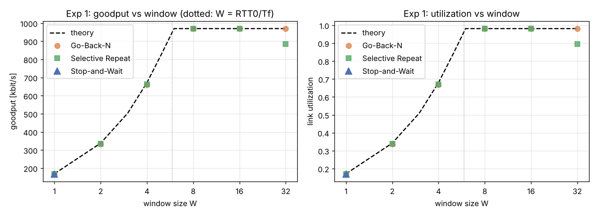
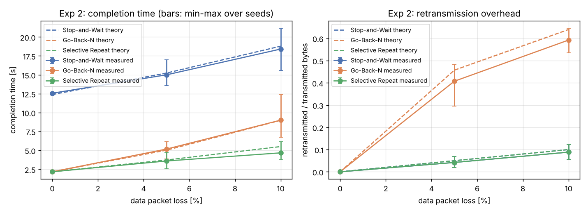
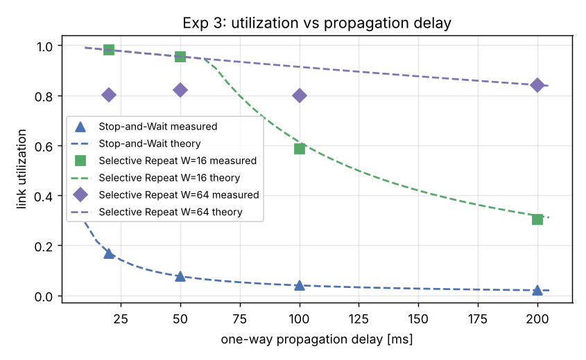
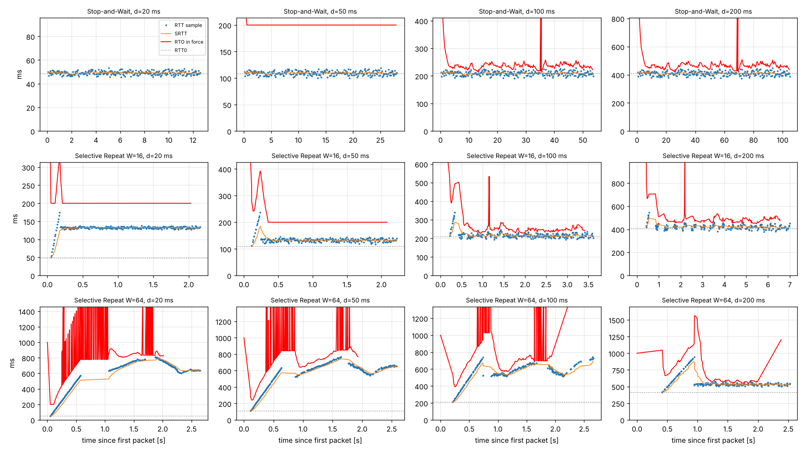
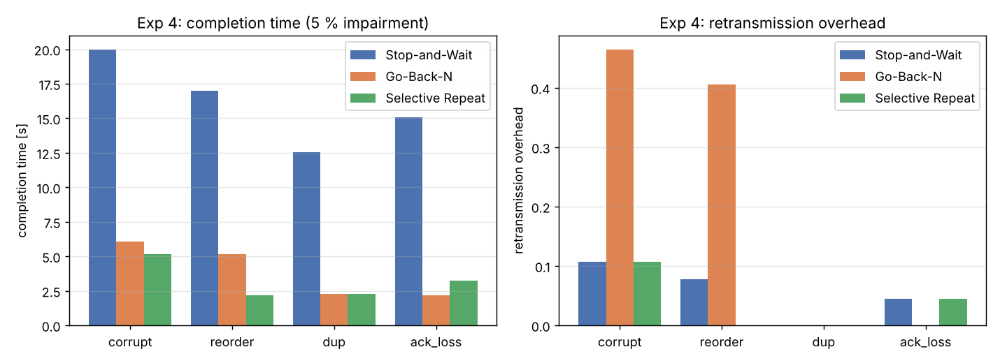
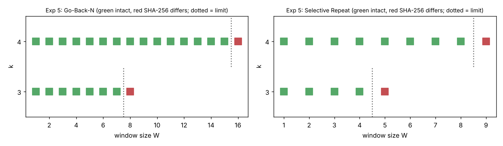

# 1. Introduction

We implemented reliable one-way file transfer over UDP with three ARQ
protocols — Stop-and-Wait (SW), Go-Back-N (GBN) and Selective Repeat (SR) —
and a separate impairment emulator that sits between sender and receiver. All
three programs are written in C (POSIX, standard library only) and run on
127.0.0.1. Python scripts run every experiment automatically and compute all
metrics from the logs.

The protocol itself (packet format, sequence numbers, timers, state machines)
is specified in the separate document *Protocol Specification*
(`docs/protocol_spec.pdf`). This report describes the emulator, the
methodology, the results of the five experiments, compares them with the
theoretical derivations (Appendix A), and lists the failure conditions and
limitations of the design.

**Baseline.** Rate R = 1 Mbit/s and propagation delay D = 20 ms per direction,
queue capacity 128 packets per direction, k = 7, W = 16, payload P = 1024 B,
file size 256 KiB (N = 256 packets), no impairments. Derived quantities used
throughout: transmission time of a data packet T_f = (1024 + 12)·8 / 10⁶ =
8.288 ms, of an ACK T_a = 0.096 ms, round-trip time with empty queues
RTT₀ = T_f + T_a + 2D = 48.384 ms, and bandwidth-delay product
RTT₀/T_f = 5.84 packets.

# 2. System overview

```
sender --DATA/FIN-->  emulator  --DATA/FIN-->  receiver
       <--ACK/FINACK--          <--ACK/FINACK--
```

| Program | Role | Log |
|------------------------|----------------------------------------------|----------------------------------------|
| `sender` | splits the file, window, timers, RTO estimator (RFC 6298, Karn) | `SEND`, `RETX`, `ACK`, `RTT`, `TIMEOUT`, `DATA_DONE`, … |
| `emulator` | full-duplex relay, link model and impairments of a scenario file | `RX`, `ENQ`, `DELIVER`, `DROP_*`, `CORRUPT`, `DUP`, `HOLD`, … |
| `receiver` | validation (CRC-32), in-order delivery / SR buffering, ACKs | `RX_DATA`, `RX_BUF`, `RX_DUP`, `ACK_TX`, `FIN_RX`, … |
| `experiments/run_experiments.py` | runs all 202 transfers, stores logs, scenarios, commands, SHA-256 | `run.json` |
| `experiments/analyze.py` | metrics, theory comparison, tables and figures | `results/summary/`, `results/plots/` |

All logs are CSV with timestamps from `CLOCK_MONOTONIC` in microseconds. The
clock is shared by all processes on the machine, so events of the three programs
can be placed on one time line.

# 3. Impairment emulator

## 3.1 Design

The emulator is a single-threaded event loop: `select()` waits for a datagram
or until the next scheduled event (a delivery, or the release of a held packet).
It owns two UDP sockets — one bound to the port the sender addresses, one on an
ephemeral port facing the receiver. The receiver answers to the source address
of the datagrams it receives, so its ACKs arrive on the second socket; that
separates the two directions. Each direction has its own rate, delay, jitter,
queue and impairment probabilities (`fwd.` / `rev.` prefixes in the scenario
file), so the link is full-duplex.

Every arriving datagram goes through these steps in a fixed order:

1. **Scenario actions** for that specific packet: `drop`, `delay`, `corrupt` or
   `dup`, matched by sequence number and occurrence (`drop data seq 12 occ 2`)
   or by arrival index (`drop ack index 0-6`).
2. **Loss**: `data_loss` drops DATA packets in the forward direction, `ack_loss`
   drops ACKs in the reverse direction. Lost packets never reach the link.
3. **Corruption**: with probability `corrupt` one uniformly chosen bit of the
   datagram (header or payload) is flipped.
4. **Duplication**: with probability `dup` an exact copy is queued right behind
   the original.
5. **Reordering**: with probability `reorder` the packet is held back; when the
   next packet of the same direction arrives, that one is queued first and the
   held one immediately after it.
6. **Link**: FIFO queue of `queue_pkts` packets (tail drop). Transmission starts
   at max(arrival, time the link becomes free) and lasts L·8/R, L = datagram size.
7. **Propagation**: delivery at end of transmission + delay + U(−j, +j). Jitter
   never reorders: a packet is not delivered before the previous packet of its
   direction (packets delayed by a scenario `delay` action are exempt, since
   their purpose is to arrive late).

The computed transmission start, transmission end and delivery time of every
packet are written to the `ENQ` log line. The analysis therefore knows exactly
when the link was busy. Deliveries are on average 0.13–0.16 ms late (99th
percentile < 0.26 ms, `DELIVER` lines), small compared with T_f = 8.288 ms.

## 3.2 Reproducibility

A random decision is not drawn from a sequential generator. In a sequential
generator the state would depend on how many packets the other direction had
already consumed, so OS timing would change the outcome. Each decision is
instead a hash:

  u = splitmix64(seed, direction, arrival index n, kind of decision) / 2⁶⁴ ∈ [0, 1)

The n-th packet of a direction therefore always gets the same fate for a given
seed, whatever happens in the other direction and whichever impairments are
enabled. Two runs with the same scenario (10 % loss + 5 % corruption + 5 %
reordering + 5 ms jitter) produced identical impairment decisions (76 of 76).
The generator is unbiased: P(u < 0.05) is between 0.0497 and 0.0502 over 10⁶
draws for seeds 1–6.

# 4. Methodology

* The test file `experiments/input.bin` (262 144 pseudo-random bytes, seed
  337) is the same in every run.
* `run_experiments.py` contains the complete run plan. For every run it writes
  the scenario file, starts receiver, emulator and sender, and afterwards
  stores the three logs, the exact command lines, the exit codes and the
  SHA-256 of the original and the received file in `results/exp<N>/<run>/`.
  All 202 runs were executed sequentially on one Linux machine.
* Every parameter not varied by an experiment is at the baseline. Exceptions:
  experiment 5 uses k = 3 and 4 by design, with `--fin-retries 4` and a 5 s
  receiver idle time so that failed transfers end quickly. Neither affects data
  transfer.
* Random impairments are repeated with several seeds: 10 per loss rate in
  experiment 2 and 3 per configuration in experiment 4. A 256-packet transfer
  sees only ≈ 13 losses at 5 %, so one run varies by about ±3.5 losses.

**Metrics**, exactly as `analyze.py` computes them:

| Metric | Definition |
|------------------|----------------------------------------------------------------------|
| Completion time T | time of `DATA_DONE` − time of the first `SEND` in the sender log: first data packet sent until the last data packet is ACKed |
| Goodput | file bytes · 8 / T |
| Retransmission overhead | retransmitted bytes / all transmitted data bytes; bytes on the wire (payload + 12), from `SEND`/`RETX` |
| Link utilization | time the forward link spends transmitting *new* data packets (first transmissions; retransmissions and emulator duplicates excluded) / T. Intervals from the emulator's `ENQ` lines; the n-th DATA arrival at the emulator is the n-th `SEND`/`RETX` of the sender |
| Integrity | SHA-256(original) = SHA-256(received) |
| RTT and RTO | `RTT` events (sample, SRTT, RTO) and the RTO recorded at every `SEND`/`RETX` |
| Realised loss rate p̂ | emulator `DROP_LOSS` lines / forward DATA arrivals |

# 5. Experiment 1 — ideal network

| Protocol | W | T meas. [s] | T theory [s] | Goodput [kbit/s] | U meas. | U theory | Retx |
|---|---|---|---|---|---|---|---|
| SW | 1 | 12.581 | 12.386 | 166.7 | 0.169 | 0.171 | 0 |
| GBN / SR | 2 | 6.287 / 6.281 | 6.201 | 334 | 0.337 | 0.342 | 0 |
| GBN / SR | 4 | 3.172 / 3.166 | 3.121 | 661 | 0.669 | 0.680 | 0 |
| GBN / SR | 8, 16 | 2.162 | 2.162 | 969.9 | 0.981 | 0.981 | 0 |
| GBN | 32 | 2.162 | 2.162 | 969.8 | 0.981 | 0.981 | 0 |
| SR | 32 | 2.370 | 2.162 | 885.0 | 0.895 | 0.981 | 25 |

{ width=100% }

Throughput grows linearly with W while W < RTT₀/T_f = 5.84 and is flat
(link-limited) from W = 8 on, as derived in Appendix A §1. In the
window-limited cases the measurement is 0.7–1.5 % slower than theory. This is
about 0.7 ms per round trip of processing and scheduling time in the three
programs, which the model ignores; it appears equally in SW, GBN and SR. In
the link-limited cases the match is exact to the millisecond, because the
bottleneck is the link, which the emulator models exactly. GBN and SR behave
identically because nothing is retransmitted on an ideal network. U stays at
0.981 rather than 1 because of the final RTT₀ in which the last ACK returns
and the link is idle.

**SR with W = 32 is the exception (25 spurious retransmissions).** With W far
above the bandwidth-delay product, the excess W − 5.84 ≈ 26 packets wait in
the emulator queue, and by Little's law the RTT grows to about W·T_f = 265 ms.
During the first window the RTT samples ramp from 48 ms to that value faster
than the estimator (gain ⅛) follows, while the RTO is still at its 200 ms
floor. SR sets each packet's deadline when the packet is *sent*, so packets
that wait in the queue longer than the RTO time out although nothing was lost.
GBN keeps one timer that is restarted on every new ACK, so it is not affected.

# 6. Experiment 2 — data packet loss

Mean over 10 seeds per loss rate. Theory (Appendix A §2) is evaluated at the
loss rate p̂ the emulator actually realised in each run. The theory at the
nominal p is also listed in `results/summary/tables.md`.

| Protocol | p | p̂ | T meas. [s] | T theory(p̂) [s] | Overhead meas. | Overhead theory(p̂) | Timeouts |
|---|---|---|---|---|---|---|---|
| SW | 5 % | 4.2 % | 15.00 | 14.77 | 0.042 | 0.042 | 11.3 |
| SW | 10 % | 8.8 % | 18.41 | 17.98 | 0.088 | 0.088 | 25.0 |
| GBN | 5 % | 4.3 % | 5.17 | 4.63 | 0.407 | 0.416 | 11.9 |
| GBN | 10 % | 9.3 % | 9.00 | 8.45 | 0.593 | 0.615 | 24.4 |
| SR | 5 % | 4.2 % | 3.59 | 3.47 | 0.042 | 0.042 | 11.3 |
| SR | 10 % | 8.8 % | 4.67 | 5.10 | 0.088 | 0.088 | 25.0 |

{ width=100% }

All 60 received files are intact.

* **Overhead.** SW and SR resend exactly the lost packets, so the measured
  overhead equals p̂ to three decimals. GBN resends the whole outstanding window
  for every loss. Its measured 41 % and 59 % agree with the expression
  1 − (1 − p)/(1 − p + pW) within 1–2 points; the measurement is slightly lower
  because the window is not always full when the timer fires (e.g. near the end
  of the file).
* **Time.** SW: theory N·(RTT₀ + RTO·p/(1−2p)) is within 1.6–2.4 %; the gap is
  the same ≈ 0.7 ms per packet as in experiment 1. SR: the stall model (the
  link idles RTO + RTT₀ − W·T_f ≈ 116 ms per loss) is accurate at 5 % (−3 %)
  and overestimates at 10 % (+9 %). At that rate two losses often fall into the
  same stall and share one wait, while the model charges each loss separately.
  GBN: within 10 %. The model charges one RTO per loss; in reality a loss
  inside a retransmitted window costs another timeout, and the RTO in force is
  up to 213 ms because RTT samples include queueing.
* **Why the costs differ.** In bytes GBN far exceeds SR = SW, because GBN resends ≈ W
  packets per loss. In time SW >> GBN > SR. SW pays RTT₀ for every packet and a
  full idle RTO per loss. GBN restarts its stream one RTO later. SR keeps the
  link busy for W·T_f of the RTO + RTT₀ wait and resends a single packet.

Because the impairment decisions depend only on the arrival index, SW and SR
runs with the same seed lose exactly the same packets: both send each packet
once, in order, until it is lost. That is why their p̂, overhead and timeout
columns are identical.

# 7. Experiment 3 — propagation delay

Delay D ∈ {20, 50, 100, 200} ms per direction with uniform jitter j = D/10;
SW, and SR with W = 16 and W = 64. Theory: Appendix A §3.

| Protocol | D [ms] | RTT₀ [ms] | RTT mean [ms] | U meas. | U theory | Timeouts |
|---|---|---|---|---|---|---|
| SW | 20 | 48.4 | 49 | 0.169 | 0.171 | 0 |
| SW | 50 | 108.4 | 109 | 0.076 | 0.076 | 0 |
| SW | 100 | 208.4 | 209 | 0.040 | 0.040 | 2 |
| SW | 200 | 408.4 | 410 | 0.020 | 0.020 | 2 |
| SR, W = 16 | 20 | 48.4 | 131 | 0.981 | 0.981 | 0 |
| SR, W = 16 | 50 | 108.4 | 135 | 0.954 | 0.955 | 0 |
| SR, W = 16 | 100 | 208.4 | 219 | 0.587 | 0.613 | 2 |
| SR, W = 16 | 200 | 408.4 | 426 | 0.303 | 0.319 | 1 |
| SR, W = 64 | 20 | 48.4 | 572 | 0.801 | 0.981 | 59 |
| SR, W = 64 | 50 | 108.4 | 557 | 0.821 | 0.955 | 43 |
| SR, W = 64 | 100 | 208.4 | 553 | 0.798 | 0.914 | 55 |
| SR, W = 64 | 200 | 408.4 | 568 | 0.840 | 0.841 | 1 |

{ width=72% }

{ width=100% }

* **Utilization.** SW collapses from 0.17 to 0.02 as U = T_f/RTT₀ predicts
  (measured within 0.002). The window needed to fill the link is
  ⌈RTT₀/T_f⌉ = 6, 14, 26 and 50 packets. SR with W = 16 is therefore
  link-limited at 20 and 50 ms and window-limited at 100 and 200 ms, where it
  reaches W·T_f/RTT₀ within 4 %.
* **RTO tracking.** For SW the RTO sits on the 200 ms floor at 20 and 50 ms,
  where SRTT + 4·RTTVAR would be below it. At 100 and 200 ms it follows the
  RTT at a margin of ≈ 20–50 ms, which grows with the jitter (±10 / ±20 ms per
  direction). The two timeouts at 100 and 200 ms (spikes in the figure) are
  single samples in the tail of the jitter that exceeded the RTO. The RTO
  doubles once and returns to normal with the next ACK. For SR W = 16 the
  samples rise from RTT₀ to ≈ W·T_f = 133 ms at small delays as the queue
  fills, and the RTO follows.
* **SR with W = 64 at 20–100 ms reaches only ≈ 0.80** instead of 0.91–0.98,
  with 43–59 timeouts. This is the W = 32 effect of experiment 1, amplified. A
  path that holds 6–26 packets carries 64, so 38–58 packets wait in the
  emulator queue and the RTT rises to ≈ W·T_f + 2D ≈ 570 ms (measured
  553–572 ms; Little's law). In the figure the samples climb linearly during
  the first window and the RTO lags behind. Packets time out while still
  queued, each timeout doubles the RTO (the vertical spikes), and the
  retransmitted copies take link time from new data. At 200 ms the path itself
  holds 50 packets, the queue stays small, and measurement and theory agree
  (0.840 vs 0.841, one timeout). A window larger than the bandwidth-delay
  product adds no throughput, only queueing delay, and with send-time-based
  timers it causes spurious retransmissions.
* **Go-Back-N (not run).** Without loss and with order-preserving jitter, GBN
  sends exactly the same packets as SR, so for the same W its completion time
  and utilization would be the same. GBN restarts its single timer on each new
  ACK, so it would not suffer SR's queue-induced timeouts. But every real or
  spurious timeout costs GBN the whole window — up to 64 packets at W = 64 —
  plus a full RTO of idle time (≥ 0.4 s at 200 ms). Large bandwidth-delay
  products make GBN increasingly expensive under any loss.

# 8. Experiment 4 — corruption, reordering, duplication, ACK loss

Each impairment alone at 5 % (corruption, reordering and duplication in both
directions), 3 seeds per protocol. **All 36 received files are identical to the
original** (SHA-256).

| Impairment | Protocol | T [s] | Overhead | Timeouts |
|------------|--------------|----------------------|------------------------|--------------------|
| corruption | SW / GBN / SR | 19.97 / 6.08 / 5.17 | 0.107 / 0.464 / 0.107 | 30.7 / 14.0 / 30.7 |
| reordering | SW / GBN / SR | 16.98 / 5.18 / 2.16 | 0.078 / 0.406 / 0 | 21.7 / 11.7 / 0 |
| duplication | SW / GBN / SR | 12.55 / 2.27 / 2.27 | 0 / 0 / 0 | 0 / 0 / 0 |
| ACK loss | SW / GBN / SR | 15.10 / 2.16 / 3.25 | 0.045 / 0 / 0.045 | 12.0 / 0 / 12.0 |

{ width=100% }

* **Corruption** affects both directions. A corrupted packet fails the CRC-32
  check and is dropped, so it behaves like the loss of a DATA *or* an ACK
  packet. SW and SR retransmit ≈ 10 % (5 % + 5 %), twice the rate of the pure
  data loss of experiment 2. GBN pays a window per corrupted DATA packet, while
  a corrupted ACK is mostly covered by the next cumulative ACK.
* **Reordering.** SR buffers the early packet and ACKs every packet
  individually, so reordering costs nothing (T = 2.162 s, the ideal value).
  The GBN receiver discards everything after the late packet; the sender
  eventually times out and resends a window (41 % overhead). GBN has no fast
  retransmit, so the duplicate ACKs (≈ 180 per run) do not help. SW is a
  special case: a held packet is released only when the next packet of its
  direction arrives. In SW that next packet is the retransmission after a
  timeout, so every reordering event costs one RTO (21.7 timeouts ≈ 5 % of
  ≈ 2·265 packets).
* **Duplication** is harmless for all three protocols. The receivers recognise
  the copy (`RX_DUP`) and ACK it again, and the senders ignore the repeated ACK.
  The only cost is the link time of the copies (2.27 s vs 2.16 s, +5 %).
* **ACK loss.** A lost GBN ACK is irrelevant: the next cumulative ACK covers
  the same packets (no retransmissions, ideal time). SR and SW acknowledge each
  packet individually, so every lost ACK means a timeout and a needless
  retransmission (overhead 4.5 % = the ACK loss rate).

# 9. Experiment 5 — sequence-number limits

Derived limits (Appendix A §4): **GBN W ≤ 2^k − 1, SR W ≤ 2^(k−1).**
Impairment: every ACK of the first window is dropped (`drop ack index 0-(W-1)`),
for every W. This is the worst case of both proofs: the receiver has received
the whole window, the sender has none of its ACKs, so it times out and resends
the entire first window. Using the same rule for every W keeps the impairment
identical in kind. Dropping a fixed number of ACKs regardless of W would make
small windows lose many retransmission ACKs in a row, and with exponential
backoff such runs last minutes without testing anything new.

| Protocol | k | W tested | Intact for | SHA-256 differs for | Derived limit |
|---|---|---|---|---|---|
| GBN | 3 | 1–8 | W ≤ 7 | W = 8 | 7 |
| GBN | 4 | 1–16 | W ≤ 15 | W = 16 | 15 |
| SR | 3 | 1–5 | W ≤ 4 | W = 5 | 4 |
| SR | 4 | 1–9 | W ≤ 8 | W = 9 | 8 |

{ width=100% }

All 38 runs agree with the derivation, and because the drops are scripted, each
failure is reproduced on every run. *GBN, k = 3, W = 8:* the receiver accepts
packets 0–7 and now expects packet 8, whose number is 8 mod 8 = 0. The sender
received no ACK, so it resends packet 0 with number 0, and the receiver writes
the old payload in place of packet 8. *SR, k = 3, W = 5:* after packets 0–4
the receiver window covers packets 5–9 with numbers {5, 6, 7, 0, 1}; the
retransmitted packet 0 falls into it and is stored as packet 8. In both cases
the transfer "completes" normally. No error is detected at the protocol level,
and only the end-to-end SHA-256 reveals the corruption.

# 10. Failure conditions and limitations

**Protocol.**

* *Window above the sequence-number limit* (experiment 5): silent corruption
  of the file. The sender only warns, so that the failure can be demonstrated.
* *No bound on packet lifetime.* The window limits assume that an old packet
  cannot arrive after its number has been reused. A packet delayed by more than
  about 2^k packet times — possible with the emulator's `delay` action, or on a
  real network with long queues — can be accepted as a new packet even when W
  respects the limit. A larger k (up to 16) makes this unlikely; TCP solves it
  with 32-bit numbers and a maximum segment lifetime.
* *SR spurious timeouts under self-inflicted queueing* (experiments 1 and 3):
  per-packet deadlines are measured from the send time. When W exceeds the
  bandwidth-delay product, the queueing delay outgrows the RTO and packets are
  retransmitted although they were not lost. Restarting deadlines when the
  window advances, or keeping W near the bandwidth-delay product, would avoid it.
* *No fast retransmit.* Duplicate ACKs are ignored, so GBN and SW recover from
  reordering only by timeout (experiment 4: 41 % overhead for GBN).
* *SW and reordering.* A reordered packet in SW is released only by the next
  packet, which is the retransmission, so each reordering costs one RTO.
* *Teardown.* If every FINACK is lost, the sender gives up after
  `--fin-retries` attempts (exit 2) although the receiver has the complete
  file. If the sender stops sending, the receiver gives up after `--idle`
  (exit 3) and keeps the partial file.
* *Checksum.* CRC-32 misses a random corruption with probability 2⁻³²
  (undetected errors would be written to the file). Every single-bit error, the
  emulator's corruption model, is detected.
* *Scope.* One transfer per process, no connection setup, no flow or congestion
  control beyond the fixed window; the sender keeps the whole file in memory;
  k ≤ 16, W ≤ 2^k, payload ≤ 1460 B; the minimum RTO is 200 ms instead of
  RFC 6298's 1 s.

**Emulator and measurements.**

* Lost packets are removed before the link (they use no link time); corrupted,
  duplicated and reordered packets do use it.
* A reordered packet is released after `max_hold_ms` (1 s) if no packet follows;
  this matters only at the end of a transfer. While one packet is held, the next
  one is not held as well.
* The queue capacity counts the packet being transmitted. No queue overflow
  occurred in the experiments (W ≤ 64 < 128).
* Timing relies on `select()` on a shared machine: deliveries are
  0.13–0.16 ms late on average, and the programs add ≈ 0.7 ms per round trip,
  so window-limited runs are up to 1.5 % slower than theory.
* A run has only ≈ 260 packets, so realised loss rates deviate from the nominal
  rate. This is why there are 10 seeds per point and theory is also evaluated at
  the realised p̂.

# 11. Reproducing the results

```
make
python3 experiments/run_experiments.py          # all 202 runs, about 25 minutes
python3 experiments/run_experiments.py 2 --only sr   # a subset
python3 experiments/analyze.py                  # metrics, tables, figures
```

Every run directory `results/exp<N>/<run>/` contains `scenario.txt` (all
emulator parameters and the seed), the three logs, `stdout.txt` and `run.json`
(all parameters, exact command lines, exit codes, SHA-256 hashes). Re-running a
scenario file with the same seed reproduces the same impairment decisions.

# 12. Division of work

| Member | Responsibilities |
|--------------|----------------------------------------------------------------------|
| Raimbek Erik | sender and receiver (SW, GBN, SR), packet format and CRC-32, RTO estimator, endpoint logging, endpoint test suite (`tests/`), protocol specification |
| Yersultan Anuar | impairment emulator, scenario format, experiment automation, analysis scripts and figures, theoretical derivations, experiments and analysis sections of this report |

Both members agreed on the packet format, the log formats and the command-line
interfaces before implementation, and integrated the three programs together.

# 13. AI use statement

*[To be written by the team: which tools were used and for what purpose, as
required by Section 5 of the assignment.]*

\newpage

# Appendix A — Theoretical derivations
